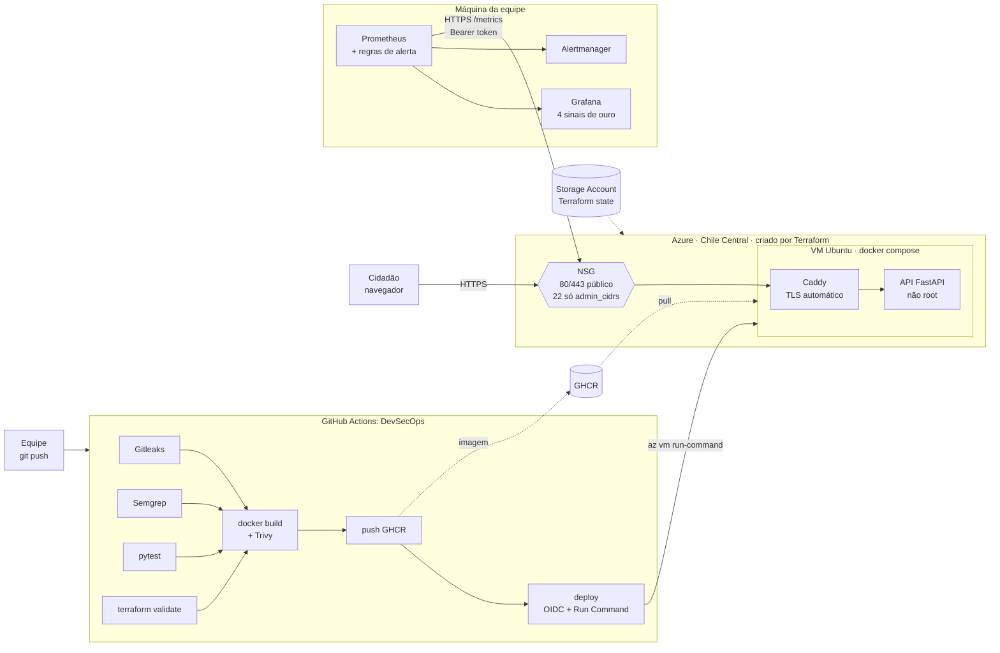

# Arquitetura

## Decisões

| Decisão | Motivo |
|---|---|
| VM com docker compose, e não PaaS | A rubrica pede a stack subindo com docker compose e controle da porta de administração. A mesma topologia roda local e em produção. |
| Caddy na frente da API | HTTPS com certificado automático no FQDN do Azure, sem domínio próprio. |
| Deploy por `az vm run-command` | O runner do GitHub não precisa de SSH. A porta 22 fica fechada ou restrita ao IP da equipe. |
| Login OIDC (identidade federada) | Não há senha ou client secret de longa duração no GitHub. O token só vale para o environment `production` deste repositório. |
| State em Storage Account com auth Entra ID | O state fica fora do repo, com versionamento e sem chave compartilhada. |
| Chile Central, B2ats_v2 e disco P6 | Cabem na cota gratuita da Azure for Students, que não oferece VM gratuita em Brazil South. Chile Central é a região permitida mais próxima. Com dados reais do cidadão, a troca para `brazilsouth` é uma variável (ver [lgpd.md](lgpd.md) e [custo.md](custo.md)). |
| Prometheus e Grafana locais | O enunciado permite. Evita custo de VM extra e não expõe o Grafana na internet. |

## Fluxo do pipeline

1. Todo push e todo PR rodam Gitleaks, Semgrep, pytest e `terraform validate` em paralelo.
2. Se tudo passar, a imagem é construída e o Trivy bloqueia vulnerabilidades HIGH e CRITICAL com correção disponível.
3. Só num push na `main`, a imagem vai para o GHCR com a tag do SHA do commit.
4. O job `deploy` entra na Azure por OIDC e roda o [deploy.sh](../deploy/deploy.sh) na VM. O script baixa o compose
   da mesma versão, troca a imagem, espera o healthcheck e falha se a API não ficar saudável.
5. O smoke test confere na URL pública se `/api/v1/info` responde com o SHA implantado.
